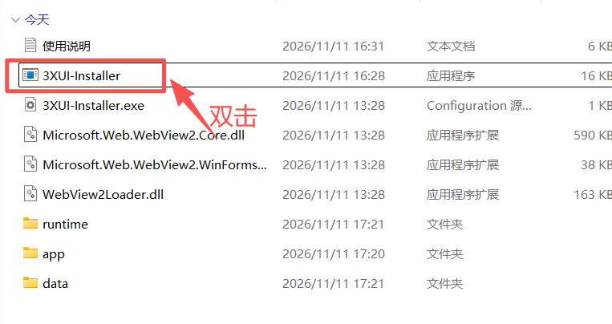
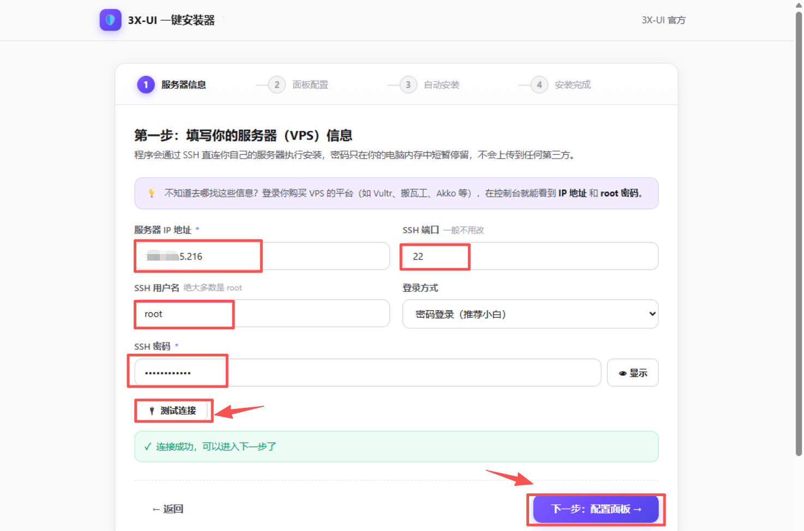
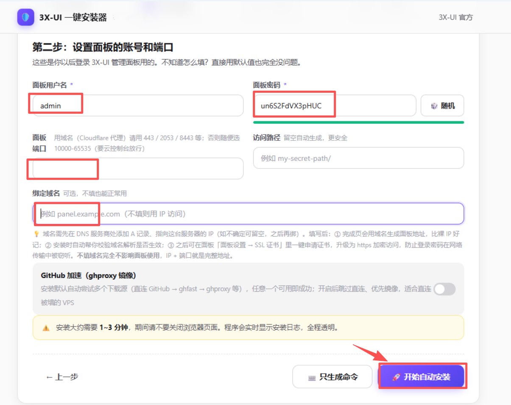
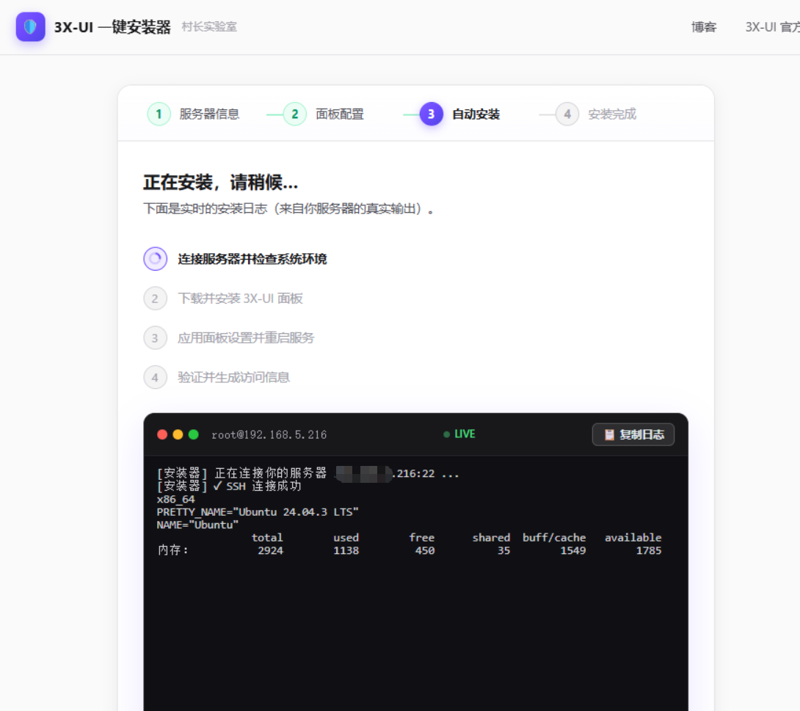
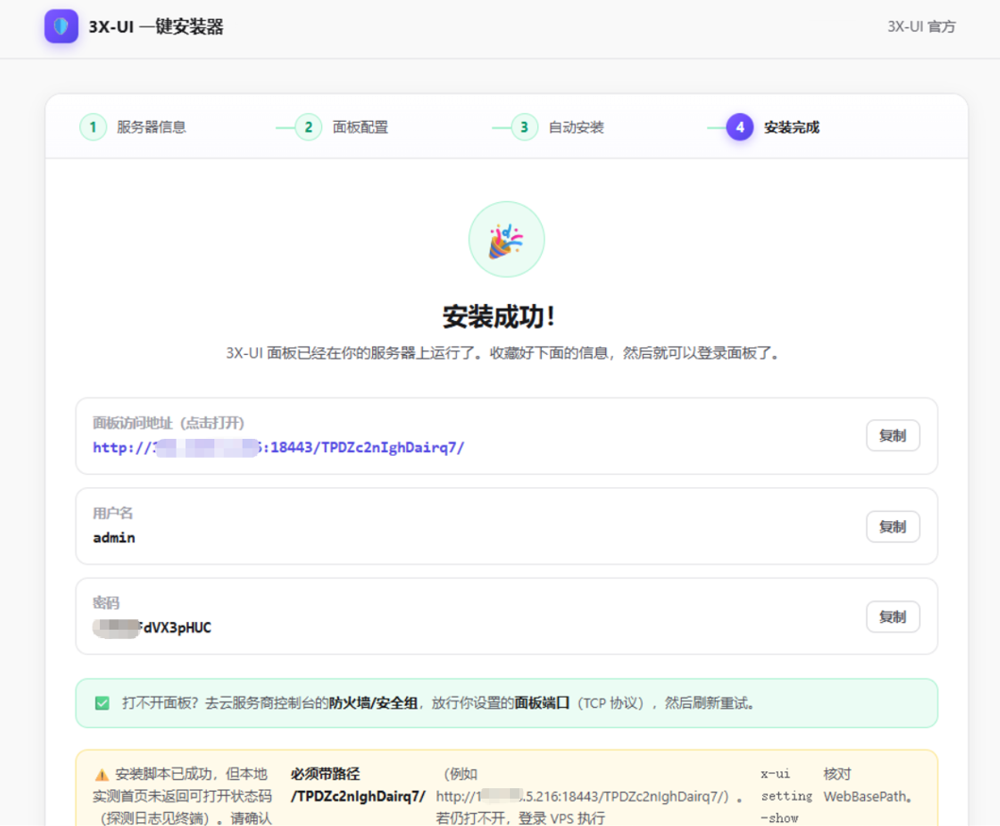
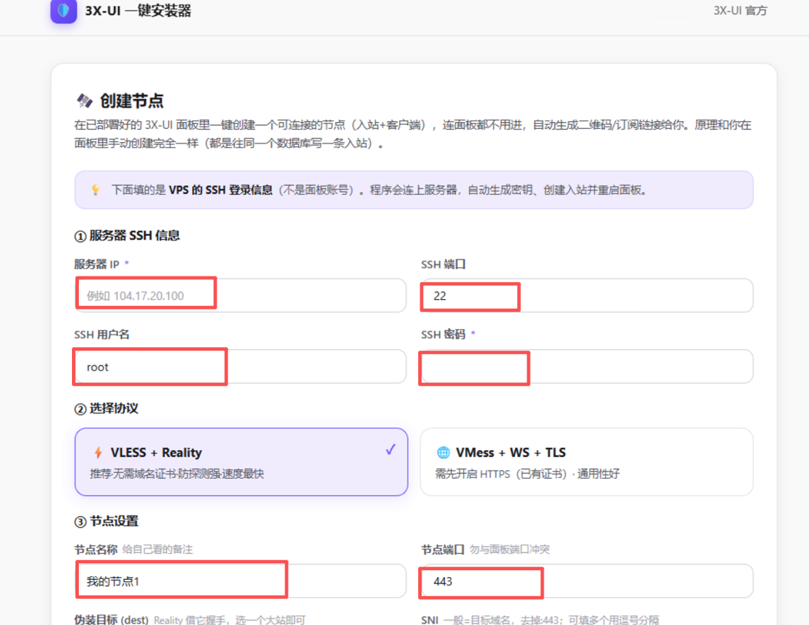

# 3X-UI 一键安装器 · 桌面版

一个 **Windows 桌面程序**：填表单、点按钮，程序通过 SSH 连上你的 VPS，调用 [3X-UI](https://github.com/MHSanaei/3x-ui) 官方安装脚本自动完成部署，最后把面板地址、账号、密码直接交给你。全程不需要命令行知识，也不需要打开浏览器。

> 本项目基于 [cunzhangcrypto/3XUI](https://github.com/cunzhangcrypto/3XUI)（Web 版，MIT）改造而来，
> 原版权归村长实验室 (czlab.dev) 所有。相对 Web 版的改动见 [主要改动](#主要改动)。
> 第三方封装工具，与 3x-ui 官方项目、与上述上游作者均无隶属关系。

## 功能特性

- 🧙 **可视化向导**：服务器信息 → 面板配置 → 自动安装 → 完成，四步搞定
- 🖥️ **独立窗口运行**：桌面外壳 + 系统 WebView2 内核，界面在程序窗口里，不占用浏览器标签页
- 📜 **官方脚本全自动**：调用官方安装脚本的非交互模式（`XUI_NONINTERACTIVE=1`），把你填的用户名 / 密码 / 端口 / 路径 / 域名自动传参
- 🔒 **域名自动申请证书 + 自动续签**：填了域名即用 `acme.sh` 签发 Let's Encrypt 证书，续签由 `acme.sh` 的 cron 任务负责，续签后自动重启面板
- 🌩️ **Cloudflare 友好端口**：面板端口默认从 CF 代理支持的端口（443 / 2053 / 8443 等）中选取，避免走 CF 代理时被直接拒绝
- 🔐 **凭据不落地**：SSH 密码只在内存中短暂停留，SSH 直连你自己的服务器，不经过任何第三方；本地服务只监听 `127.0.0.1`
- 👁️ **认证方式自适应**：探测服务器支持的认证方式，兼容 password 与 keyboard-interactive（PAM）两种密码认证，密码正确却报认证失败的情况已修复
- 🚀 **一键创建节点**：安装完成后可在界面直接创建 VLESS + Reality 入站节点（Flow 选 `xtls-rprx-vision`）
- 🧰 **附带面板急救箱**：忘记面板账号、密码或端口时，可直接查看 / 重置，无需登录面板

## 它是怎么工作的

```
桌面窗口（WebView2 内核，渲染界面）
      │  本地回环 127.0.0.1:3930
内置 Node.js 服务（Express + Socket.IO + SSH2）
      │  SSH 加密直连
你的 VPS（执行 3X-UI 官方安装脚本）
```

窗口外壳随窗口启动 / 关闭本地服务：关掉窗口即整体退出，不留后台进程。

## 使用方法

整个流程是「解压 → 填服务器信息 → 配面板账号端口 → 等它装 → 拿到地址 → 建节点」，熟练的话 3~5 分钟能走完。

> 📄 想要可以转发、打印的图文版？下载 Word 教程：[3X-UI桌面版使用教程.docx](docs/3X-UI桌面版使用教程.docx)（10 页，含全部步骤截图）。

### 第 1 步：下载、解压、启动

到 [Releases](../../releases) 下载最新的 `3XUI-install-desktop-v*.zip`，解压到任意目录。解压后应当是这样：



- 双击 `3XUI-Installer.exe` 启动，**不需要装 Node.js，也不会打开浏览器**
- `app\`、`runtime\` 两个文件夹必须跟 exe 放在一起，不要单独挪走或改名
- `data\` 是首次运行时自动生成的缓存目录（WebView2 缓存、运行日志），删掉会自动重建
- 首次启动约 2~4 秒；程序只监听 `127.0.0.1:3930`，不对外暴露端口

> 提示缺少 WebView2？按弹窗给的微软官方地址装一次运行时即可，约 2 MB。

更新版本时先关闭正在运行的程序，再解压覆盖；`data\` 目录运行中被占用会导致覆盖失败。

### 第 2 步：填写服务器信息



| 字段 | 怎么填 |
| --- | --- |
| 服务器 IP 地址 | VPS 的公网 IP，在云服务商控制台首页能看到 |
| SSH 端口 | 一般是 `22`；改过 sshd 端口的填实际端口 |
| SSH 用户名 | 绝大多数服务器是 `root` |
| 登录方式 | 新手选「密码登录」；已有密钥的选「密钥登录」并粘贴私钥 |
| SSH 密码 | VPS 的 root 密码，**不是**面板密码，也不是云平台账号密码 |

填好点「测试连接」，等到出现绿色的「连接成功，可以进入下一步了」，再点右下角「下一步：配置面板」。

测试连接常见提示的含义：

- **服务器不接受密码登录（只允许 publickey）**：这台机关掉了密码登录，把登录方式切成「密钥登录」
- **连接被拒绝**：端口没开放 SSH 服务，多半是 SSH 端口填错了
- **连接超时 / 连接被中断**：云安全组没放行 SSH 端口，或本机网络抖动，稍等重试
- **SSH 认证失败**：用户名或密码不对；Ubuntu / Debian 默认锁定 root 密码，需要先在服务器上放开

### 第 3 步：设置面板账号和端口



| 字段 | 建议 |
| --- | --- |
| 面板用户名 / 密码 | 默认 `admin` + 随机密码，可点「随机」换一个，**务必记下来** |
| 面板端口 | 10000–65535 之间；域名走 Cloudflare 代理时必须用 CF 支持的端口（443 / 2053 / 8443 等） |
| 访问路径 | 留空自动生成随机路径，更安全；也可以自己填 `my-secret-path/` |
| 绑定域名 | 可选。填了会在安装时一并申请 Let's Encrypt 证书，前提是域名已解析到这台机、且临时放行 TCP/80 |

VPS 访问 GitHub 慢或不通时，打开「GitHub 加速（ghproxy 镜像）」开关，安装时会自动尝试镜像源。

点「开始自动安装」。**安装约 1~3 分钟**，期间别关窗口。

> 只想自己在服务器上手动跑？点「只生成命令」，复制那条命令到任意 SSH 客户端执行，效果完全一致。

### 第 4 步：等待自动安装



四个阶段会自动推进：

1. 连接服务器并检查系统环境
2. 下载并安装 3X-UI 面板
3. 应用面板设置并重启服务
4. 验证并生成访问信息

下方黑框是**服务器上的真实输出**，逐行实时回显，可随时「复制日志」。卡住时先看最后几行：多半是网络拉不动安装包（开 GitHub 加速）、磁盘或内存不足，或者系统版本不受支持。

### 第 5 步：拿到面板地址和账号



安装完成后直接给出三样东西，每项都能一键复制：

- **面板访问地址**：形如 `http://你的IP:18443/TPDZc2nIghDairq7/`，**末尾那串随机路径必须带上**，少了会 404
- **用户名 / 密码**：登录面板用，建议登录后立刻改掉

打不开面板时按顺序查：① 云控制台的防火墙 / 安全组是否放行了面板端口（TCP）；② 地址里的访问路径是否完整；③ 仍不行就到服务器上执行 `x-ui setting -show`，核对 `WebBasePath`。

### 第 6 步：创建节点（可选，但通常需要）

装好面板只是有了管理后台，还得建入站才能用。回首页点「创建节点」：



1. **服务器 SSH 信息**：和第一步一样，填 IP、端口、密码（这里是 VPS 的 SSH 登录信息，不是面板账号）
2. **选择协议**：
   - **VLESS + Reality**（推荐）：不需要域名和证书，抗探测，速度最快
   - **VMess + WS + TLS**：需要先配好域名和 HTTPS 证书，通用性更好
3. **节点设置**：节点名称（自己看的备注）、节点端口（别和面板端口冲突）、伪装目标 `dest`、`SNI`

提交后程序会连上服务器自动生成密钥、写入入站并重启面板，最后给你二维码和订阅链接。原理和在面板里手动建入站完全一致，都是往同一个数据库写一条记录。

> 也可以自己进面板手动建：用第 4 步拿到的地址登录，在「入站列表」里新建。

### 环境要求

- Windows 10 / 11（64 位）
- 已安装 Microsoft Edge WebView2 Runtime（Win11 自带，Win10 多数随新版 Edge 已装；缺失时程序会提示下载地址）
- 一台干净的 Linux VPS（Ubuntu 20.04+ / Debian 11+ / CentOS 8+ 等）

## 域名、证书与端口

- **想用域名访问**：在「面板配置」填域名，工具自动申请 Let's Encrypt 证书，完成后用 `https://你的域名:端口/路径/` 访问
- **⚠️ 前置条件**：签发证书时 VPS 安全组需**临时放行 TCP/80**；签发完成后 80 可关，但面板端口需保持开放
- **Cloudflare 代理**：域名走 CF 橙色代理时，面板端口必须是 CF 支持的端口（443 / 2053 / 2083 / 2087 / 2096 / 8443 / 80 / 8080 等）
- **裸 IP 访问**：不开代理时直接 `http://你的IP:端口/路径/`（未申请证书时为 HTTP 明文）

## 主要改动

相对上游 Web 版，本仓库的改动集中在「把浏览器页面装进桌面窗口」以及若干可用性修复：

1. 新增桌面外壳 `desktop/Program.cs`：单实例、内嵌启动与回收本地服务、外链交给系统浏览器、缺少 WebView2 时给出提示
2. 认证兼容：探测服务器支持的认证方式，支持 keyboard-interactive，修正「密码正确却提示认证失败」
3. 错误归因：区分认证失败、只允许密钥、连接中断、超时、算法协商失败等，不再一律报认证失败
4. 稳定性：私钥格式错误不再导致本地服务崩溃；端口占用给出明确提示
5. 界面文案与链接调整（品牌改为桌面版、新增 VPS 服务商快捷入口）

## 从源码构建

```bash
# 1. 安装依赖
npm install --omit=dev

# 2. 准备运行时与外壳依赖
#    - Node.js 便携版 runtime/node.exe（建议 20.x LTS，win-x64）
#    - WebView2 SDK 的托管 DLL 与 WebView2Loader.dll（Microsoft.Web.WebView2 包）
# 3. 编译桌面外壳（.NET Framework 4.x，x64）
csc -target:winexe -platform:x64 -optimize+ ^
  -r:System.dll -r:System.Drawing.dll -r:System.Windows.Forms.dll ^
  -r:Microsoft.Web.WebView2.Core.dll -r:Microsoft.Web.WebView2.WinForms.dll ^
  -out:3XUI-Installer.exe desktop\Program.cs

# 4. 组装目录：3XUI-Installer.exe + 上面的 DLL + app\(server.js、public、node_modules) + runtime\node.exe
```

## 目录结构

```
.
├── server.js                  # 后端：Express + Socket.IO + SSH2 安装编排
├── public/index.html          # 前端向导（单文件）
├── start.bat                  # 浏览器版启动脚本（兼容保留）
├── desktop/Program.cs         # 桌面窗口外壳源码
├── docs/images/               # 使用说明配图
├── package.json
├── LICENSE                    # MIT（双版权）
├── THIRD-PARTY-NOTICES.md     # 第三方组件与许可
└── .gitignore
```

发布产物（Release 压缩包）另含 `runtime\node.exe`、`app\node_modules`、WebView2 DLL 等二进制，不纳入版本库。

## 安全提示

- 仅供个人学习与合法用途，请遵守你所在地区的法律法规，且仅对自己有管理权限的服务器使用
- 安装后请尽快修改面板默认密码、开启二次验证
- 不要分享或截图包含明文密码的安装命令
- 本程序不采集、不上传任何凭据；但请自行确认下载来源可信

## 致谢

- [MHSanaei/3x-ui](https://github.com/MHSanaei/3x-ui) —— 面板本体与官方安装脚本（GPL v3）
- [cunzhangcrypto/3XUI](https://github.com/cunzhangcrypto/3XUI) —— 本项目所基于的 Web 版，© 村长实验室 (czlab.dev)
- [村长实验室 czlab.dev](https://czlab.dev) —— 界面配色与风格参考
- [xterm.js](https://xtermjs.org/)、[Socket.IO](https://socket.io/)、[ssh2](https://github.com/mscdex/ssh2) —— 终端、实时通信与 SSH 实现

## 推广链接披露

界面与文档中出现的部分 VPS 服务商链接（Vultr、搬瓦工、ZoroCloud、Dmit 等）含推广参数，
通过此类链接购买可能为作者带来佣金，不影响你的购买价格，也不构成对这些服务商的背书。

## 免责声明

本工具按「现状」提供，不附带任何明示或暗示担保。使用者应自行确保对目标服务器的操作权限，
并自行承担使用本工具造成的全部后果；作者不对任何直接或间接损失承担责任。

## License

本项目代码以 [MIT License](./LICENSE) 发布：

- Copyright (c) 2026 村长实验室 (czlab.dev) —— 原始 Web 版
- Copyright (c) 2026 Jasson —— 桌面版改造部分

第三方组件许可详见 [THIRD-PARTY-NOTICES.md](./THIRD-PARTY-NOTICES.md)。
本项目不包含 3X-UI 的源码或二进制，仅在运行时调用其官方安装脚本；3X-UI 遵循 GPL v3。
